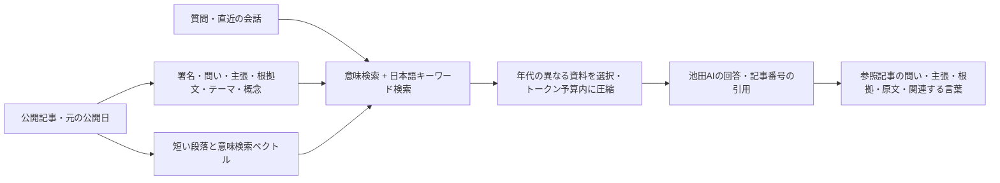

# 池田AIと時系列アーカイブ

許可済みのパンラボ・朝日新聞「このパンがすごい！」の記事から、年代と論点をたどれるブログと、原文を根拠に回答するチャットを提供する。公開日は `blog_posts.published_at` を日本時間で扱い、元記事は変更しない。



## データ

- `blog_posts`: 原文と公開日。`lib/ikeda-sources.ts`に定義した公開中の転載許可済み記事だけを索引にする。
- `ikeda_documents`: 元記事のSHA-256、索引バージョン、検索用本文、`thought` JSON、テーマ・概念。JSONは署名の確認度、署名の根拠文、要約、問い、主張、主張の理由、実在する原文引用、話者を区別する。引用が原文に存在しない主張は保存しない。
- `ikeda_chunks`: 原文を短い段落に分けたもの。既存のGeminiベクトルは保持する。
- `ikeda_chunk_embeddings`: 段落ID・モデル・原文ハッシュとOpenAI `text-embedding-3-small` の768次元ベクトル。pgvector/HNSWとpg_trgmの語句検索を併用する。モデルと原文ハッシュの一致する行だけを検索し、異なるモデルのベクトルを混ぜない。
- `ikeda_daily_usage`: 日別・分単位の利用数と実使用トークン。IPアドレスをHMACでハッシュ化し、生のIPや質問・回答・会話本文をDBに保存しない。

記事の語り手・取材相手・他筆者を分ける。無署名記事を池田浩明本人の文章と断定しない。AIの読み解きは原文の事実と区別し、私的な心理や思想の変化を推測で補わない。年代比較では時期の離れた資料も検索し、題材・筆者の差を思想の変化と取り違えない。

## 制限とコスト

唯一の正本は [`lib/ikeda-config.ts`](../lib/ikeda-config.ts)。段落サイズ、文脈・会話・出力のトークン予算、検索件数、索引バージョン、モデル名、分・日・訪問者ごとの上限をここから参照する。`js-tiktoken`で投入前に文字列のトークンを数え、APIが返す実使用量を集計する。全記事約197万トークンを毎回渡す方法は使わず、関連段落だけを渡す。

検索は意味検索とキーワード検索の順位を統合し、同じ記事の段落が占めすぎないように選ぶ。年代比較では前後の年の資料を優先する。記事から入った質問はその記事を起点とし、関連する他の記事も検索する。確かな根拠がない場合は回答できない範囲を伝える。

OpenAIの索引作成は複数の段落をまとめ、`lib/ikeda-config.ts` の間隔を空けて送り、プロバイダーのRetry-Afterを尊重する。公開チャットは全体毎分4回まで。ChatGPT Pro特典のAPIクレジットは紐付けたAPI組織で消費される。チャットのトークン予算・利用上限は引き続き同じ設定から参照する。

## 接続・運用

OpenAI Responses APIとEmbeddings APIへ直接接続する。API特典が有効な組織のキーを `OPENAI_API_KEY` としてサーバーに設定する。必要なら同じ組織・プロジェクトの `OPENAI_ORG_ID` / `OPENAI_PROJECT_ID` を明示する。キーをコード・ブラウザ・チャットへ露出させず、Vercel AI Gatewayの残高・OIDC・他アカウントへフォールバックしない。

本番を切り替える前に、下記のバックフィルで新しい意味検索ベクトルを別テーブルへ保存し、readiness.missingが0であることを確認する。元の記事・思考索引・旧ベクトルは保持する。バックフィルは `.cache/ikeda-openai/` を再利用し、中断後も未保存の段落だけを再開する。

```sh
npm run ensure:tables
# 接続後の初回だけ。書き込まない確認と、OpenAI埋め込みの再開可能な追加保存。
node --env-file=.env.local --import=tsx scripts/backfill-ikeda-embeddings.ts
node --env-file=.env.local --import=tsx scripts/backfill-ikeda-embeddings.ts --write
node --env-file=.env.local --import=tsx scripts/index-ikeda.ts
npx vitest run
node --env-file=.env.local --import=tsx scripts/verify-ikeda-index.ts
```

索引作成は新規記事・本文変更・索引バージョン変更だけを対象とする。`.cache/ikeda/`に解析結果と埋め込みを保存して再開する。ブログの本文を修正した場合は元記事のハッシュと索引を同期する。公開読み取り中にDDLや全件の再解析は行わない。

## 画面とAPI

- `/blog`: 年、テーマ、語句、新しい順／古い順、月ごとの見出し、ページ送り。質問欄から `/blog/chat` へ移る。自由入力の質問はURLに入れずsessionStorageで一度だけ渡す。
- `/blog/chat`: 独立したチャット画面。新規会話、ブラウザ内の履歴、停止、コピー、参照記事のサイドパネル。根拠文や関連概念から続きを掘る。履歴はブラウザの保存上限内に制限する。
- `POST /api/ikeda/chat`: 同一オリジンのJSONだけを受け付ける。入力検証・利用枠確保・検索・トークン圧縮後に生成する。SSEは `sources` → `delta` → `done`、失敗時は `error`。クライアントが停止したら生成も中断する。成功時の参照記事は回答中で引用された実在資料だけ。
- `GET /api/ikeda/article/<slug>`: 公開中で元記事と索引が同期している資料の構造化データだけを返す。

資料本文・会話・ユーザーの指示をシステム命令として実行しない。引用番号からだけ参照リンクを作り、モデルが作った外部リンクは表示しない。記事の非公開化は検索・詳細データのどちらにも反映する。ストリーム中の引用符は原文と完全一致する場合だけ残し、直接引用は最大2件とする。取材形式の記事の引用文は、筆者自身の主張と確定できなければ話者未確認へ補正する。

## 主な一次資料

- [ChatGPT契約のAPIクレジット特典](https://help.openai.com/en/articles/20001626-api-credits-benefit-for-eligible-chatgpt-subscriptions)
- [OpenAI Embeddings](https://developers.openai.com/api/docs/guides/embeddings)
- [OpenAI Structured Outputs](https://developers.openai.com/api/docs/guides/structured-outputs)
- [Neon pgvector](https://neon.com/docs/extensions/pgvector)

## 公開確認（2026-11-18）

初回公開時は1,941記事を索引化。UI・検索・Unicodeの切り出し・引用検証の13件のテスト、型検査、本番ビルドを実行した。本番で元記事の本文・公開日・全記事のサイトマップ登録を確認し、年代比較では2009・2015・2016・2024年の記事を参照できた。代表質問の実測入力は3,748〜3,948トークン、検索文脈は3,096〜3,351トークン。これは代表例であり、回答の正しさや一定のトークン量を保証する数値ではない。

全件の機械的な照合は `npm run verify:ikeda`。補修する場合は `-- --repair --resume` を付ける。再開用の計画は元記事のハッシュ・モデル・索引バージョンが一致する場合だけ使用し、未補修の記事だけを対象にする。結果は `.cache/ikeda/verification.json`、公開表示の確認結果も同ディレクトリへ保管する。


## OpenAI直接接続の切り替え確認（2026-11-23）

ProのAPI特典を受け取った組織のキーで接続を確認し、既存のNeonを継続したまま7,940段落を別テーブルに追加保存した。全2,489記事・3,742件の引用・原文ハッシュ・768次元の検索データを照合し、欠損と問題は0件。日本語・英語・簡体字中国語・韓国語で記事の回答と出典を確認し、表示言語を回答指示へ明示した。小麦と地域文化の横断検索では4言語とも関連資料を取得し、無関係な宇宙機器の質問は資料0件だった。

本番切り替えには同じ組織のキーをVercel本番へSensitive変数として登録する必要がある。ローカルの設定だけでは本番は変わらない。今回作成したキーの有効期間は利用者が選択した30日であり、期限前の更新が必要。キー・特典の有効期限と残高はOpenAI側で管理し、特典額をアプリの固定値にしない。
